  
  
  
  

## Flagship: [AI Job Finder](https://ai-j0b-finder.streamlit.app/)

A Python-based job-discovery application that collects opportunities and compares them against a candidate profile. Its matching logic uses explicit, rule-based signals so results can be reviewed rather than treated as unexplained AI decisions.

Job discovery · profile matching · explainable scoring · ranked results

## Selected work

  
  

  
  

  Live projects: <a href="https://ai-j0b-finder.streamlit.app/">AI Job Finder</a> · <a href="https://slayxx049.github.io/build-port/">Portfolio</a> &nbsp;|&nbsp;
  Other work: <a href="https://github.com/slayxx049/my-ai-agent">YouTube Automation Agent</a> · <a href="https://github.com/slayxx049/applocker">App Locker</a>

## Stack

  
  
  

